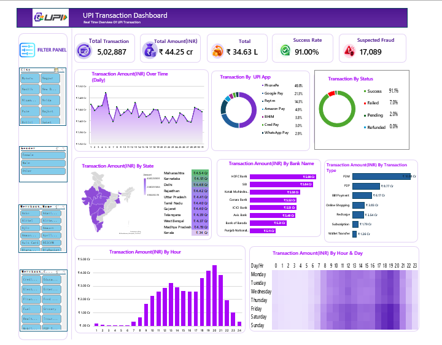

<div align="center">

# 💳 UPI Transaction Analytics Dashboard

### Turning UPI Transaction Data into Actionable Insights

An interactive dashboard for analyzing UPI payment trends, transaction performance, bank-wise activity, geographic distribution, and suspected fraud indicators.

<br>


<br>



<br>

**Explore transaction patterns. Analyze performance. Discover insights.**

</div>

---

## 📌 Overview

The **UPI Transaction Analytics Dashboard** transforms transaction data into meaningful visual insights through an interactive and visually organized dashboard.

The project provides an overview of transaction performance and enables users to explore patterns across payment applications, banks, states, transaction types, transaction statuses, and time periods.

By combining key performance indicators (KPIs) with interactive visualizations, the dashboard makes financial transaction data easier to understand and analyze.

### 🎯 Project Objectives

- Monitor overall UPI transaction performance.
- Analyze transaction amounts across different categories.
- Understand transaction success, failure, pending, and refund patterns.
- Explore bank-wise and state-wise transaction distribution.
- Identify peak transaction hours and recurring time-based patterns.
- Examine transactions flagged as potentially fraudulent.

---

## ✨ Dashboard Features

| Feature | Description |
|---|---|
| 📊 KPI Overview | Displays total transactions, total transaction amount, success rate, and suspected fraud count. |
| 📈 Transaction Trends | Tracks transaction amounts over time. |
| 📱 UPI App Analysis | Compares transaction distribution across payment applications. |
| ✅ Transaction Status | Analyzes successful, failed, pending, and refunded transactions. |
| 🗺️ Geographic Analysis | Visualizes transaction amounts across states. |
| 🏦 Bank Analysis | Compares transaction amounts by bank. |
| 💸 Transaction Type Analysis | Examines payment categories such as P2P, P2M, bill payments, and online shopping. |
| 🕒 Hourly Analysis | Identifies transaction amount patterns across different hours. |
| 🔥 Day–Hour Heatmap | Highlights transaction patterns across days of the week and hours. |
| 🎛️ Interactive Filters | Enables focused exploration using the available dashboard filters. |

---

## 📊 Key Performance Indicators

The dashboard highlights important metrics for understanding transaction performance.

| KPI | Purpose |
|---|---|
| Total Transactions | Measures the number of transactions in the selected data. |
| Total Transaction Amount | Represents the total transaction value in INR. |
| Success Rate | Measures the percentage of transactions marked successful. |
| Suspected Fraud | Counts transactions flagged as potentially fraudulent. |
| Transaction Amount by Hour | Shows how transaction value varies throughout the day. |
| Transaction Amount by State | Compares transaction value across states. |
| Transaction Amount by Bank | Evaluates transaction value across banks. |
| Transaction Amount by Type | Compares transaction value across payment categories. |

### 🧮 KPI Calculations

**Transaction Success Rate**

Success Rate = (Successful Transactions / Total Transactions) × 100

**Suspected Fraud Rate**

Suspected Fraud Rate = (Transactions Flagged as Suspected Fraud / Total Transactions) × 100

*Note: These formulas assume consistent transaction definitions. The suspected fraud rate should only be calculated if the source dataset supports it. Suspected fraud does not necessarily mean confirmed fraud.*

---

## 🔍 Business Questions

This dashboard can help investigate the following questions:

1. How does transaction value change over time?
2. Which UPI applications account for the largest share of transactions?
3. Which banks contribute the highest transaction value?
4. Which states have the highest transaction amounts?
5. What percentage of transactions are successful, failed, pending, or refunded?
6. During which hours is transaction activity highest?
7. How does transaction value vary across payment categories?
8. How are transactions flagged as potentially fraudulent distributed across available categories?

These questions can support exploratory analysis and business discussions. Actual findings should be derived from and validated against the underlying dataset.

---

## 🧰 Tools & Technologies

Update this section to reflect the tools actually used in your project.

- **Dashboard & Visualization:** Power BI *(if applicable)*
- **Data Preparation:** Power Query, Excel, or Python *(include only the tools used)*
- **Data Source:** UPI transaction dataset
- **Version Control:** Git and GitHub

---

## 🗂️ Project Structure

```text
UPI_Transaction_Analytics_Dasboard/
│
├── assets/
│   └── upi-dashboard.png
│
├── data/
│   └── README.md
│
├── UPI-Transaction-Dashboard.pbix
│
└── README.md
```

**Repository contents:**

- `assets/upi-dashboard.png` — dashboard screenshot.
- `data/README.md` — dataset source, column descriptions, and data preparation notes.
- `UPI-Transaction-Dashboard.pbix` — Power BI report file, if applicable.
- `README.md` — project documentation.

*The structure above is a suggested example. Adjust it to match your actual repository files.*

---

## 🚀 Getting Started

1. Clone or download this repository.
2. Open the dashboard file in the application used to build the report.
3. Connect the report to the appropriate dataset if required.
4. Refresh the data when appropriate and permitted.
5. Explore the dashboard using its available filters and visualizations.

For reproducibility, document the dataset source, reporting period, data-cleaning process, and KPI calculation logic.

---

## 💡 Future Enhancements

- [ ] Add a date-range filter.
- [ ] Add a reset-filters option.
- [ ] Create a dedicated fraud-analysis page.
- [ ] Introduce dynamic business insight cards.
- [ ] Improve chart readability and accessibility.
- [ ] Add a detailed data dictionary.
- [ ] Document data-cleaning and transformation steps.
- [ ] Validate KPI calculations and data quality.
- [ ] Add findings based on verified results from the dataset.

---

## ⚠️ Data & Interpretation

The accuracy of the dashboard depends on the quality of the source data and the definitions used for each metric.

Before interpreting results, verify:

- Dataset source and reporting period.
- Currency units and transaction amount definitions.
- Transaction status classifications.
- The meaning of suspected fraud labels.
- Duplicate records and missing values.
- Whether metrics update correctly when filters are applied.

**Important:** Transactions flagged as suspected fraud should not be presented as confirmed fraudulent transactions unless the dataset explicitly establishes that status.

Do not publish confidential, personal, or unlicensed transaction data.

---

## 👨‍💻 Author

<div align="center">

### Suayush Kumar Das

**Data Analytics | Dashboard Design | Business Insights**

[GitHub Profile](https://github.com/SuayushkumarDas)

</div>

---

<div align="center">

⭐ **If you find this project useful, consider giving the repository a star!**

*Turning data into insights through visualization and analytical thinking.*

</div>
